임상 특성을 활용한 심장질환 분류와 머신러닝 모델 비교

Kaggle 심장질환 데이터 918건의 탐색적 분석과 7개 분류 모델 평가

| 성명 | 학번 | 학과 |

|---|---|---|

| 서용위 | 2023045441 | 경영학과 |

| 석완군 | 2023029025 | 경영학과 |

| 장형윤 | 2022001876 | 경영학과 |

| 왕윤택 | 2024093427 | 유기나노공학 |

## 분석 요약

훈련 데이터의 5겹 교차검증에서 Random Forest가 평균 ROC-AUC 0.9331로 가장 높았다. 이 모델의 보류 테스트 ROC-AUC는 0.9387, 정확도는 90.22%, 재현율은 94.12%였다. 테스트 184건에서 위음성 6건과 위양성 12건을 기록했다. ST_Slope가 가장 큰 순열 중요도를 보였으나, 이를 인과적 위험 요인으로 해석할 수는 없다.

본 연구는 기록된 심장질환 유무를 분류하는 교육용 분석이다. 미래 발병 위험, 심부전 사망 또는 일반 인구의 유병률을 추정하지 않는다. 15개 분석 그림과 모든 결과 표는 함께 제공하는 노트북을 실제 실행하여 생성했다.

데이터: fedesoriano의 Heart Failure Prediction Dataset
https://www.kaggle.com/datasets/fedesoriano/heart-failure-prediction

---

# 1 서론

## 1.1 연구 배경과 분석 범위

임상 자료에서 질환 표지가 있는 기록과 없는 기록을 구분하는 문제는 표 형식 데이터에 대한 머신러닝의 특성과 한계를 함께 살펴볼 수 있는 과제이다. 연령과 혈압처럼 수치로 측정된 정보뿐 아니라 흉통 유형, 심전도 분류, 운동 유발 협심증 같은 범주형 정보가 함께 존재하므로 데이터 유형에 맞는 전처리가 필요하다.

이번 데이터는 파일명과 공개 제목에 Heart Failure라는 표현이 있지만 목표 열은 HeartDisease이다. 따라서 본 보고서는 심장질환 표지의 유무 분류로 연구 문제를 한정한다. 관찰 시점의 임상 기록에 대한 분류이며, 몇 년 뒤 질병이 생기는지 예측하는 추적 연구로 해석하지 않는다. 또한 원자료의 0 표지는 심장질환 부재를 의미하며 모든 건강 문제가 없다는 뜻은 아니다.

## 1.2 연구 질문

첫째, 데이터에 어떤 품질 문제가 존재하며 이를 어떻게 처리해야 하는가?

둘째, 연속형 및 범주형 임상 특성은 HeartDisease 표지와 어떤 관련을 보이는가?

셋째, 동일한 전처리와 분할 아래에서 7개 모델의 판별 성능과 안정성은 어떻게 다른가?

넷째, 재현율을 우선하는 임계값 선택과 파생 변수 추가는 실제 평가 결과를 개선하는가?

## 1.3 참고 보고서와의 대응

| 참고 PDF의 분석 단계 | 이번 분석의 적용 |

|---|---|

| 서론 및 데이터 소개 | 분류 목표, 출처, 12개 변수와 품질 점검 |

| EDA 그림 1부터 8 | 목표 분포, 결측, 분포, 집단 비교, 상관, 산점도, IQR, 집단별 표지 비율 |

| 전처리 및 7개 모델 비교 | Pipeline 기반 대체와 원핫 인코딩, 5겹 훈련 교차검증 |

| 결과 그림 9부터 15 | 성능, ROC와 PR, 혼동 행렬, 중요도, 교차검증, 레이더 |

| 토론 및 결론 | 임계값, 제거 실험, 표본 불균형과 외부 검증 한계 |

---

# 2 데이터셋 소개

## 2.1 출처와 확보 절차

선정 데이터는 Kaggle의 fedesoriano가 공개한 Heart Failure Prediction Dataset이다[1]. 공개 설명에서는 여러 UCI 심장질환 자료와 Statlog Heart를 통합한 자료로 소개한다[2, 3]. 실제 분석 파일은 Kaggle 직접 다운로드 연결의 제한으로 Kaggle 출처를 명시한 공개 GitHub CSV 미러에서 확보했다[4]. Kaggle 배포 파일과의 바이트 단위 동일성은 확인하지 못했으므로 이를 출처의 한계로 명시한다.

확보한 파일은 918행과 12열이며, 11개 입력 변수와 1개 목표 변수로 구성된다. 명시적인 NA는 0개, 전체 열이 일치하는 중복 행은 0개였다. 단, 환자 ID와 기관 변수가 없어 서로 다른 행이 반드시 서로 다른 환자라는 점까지 검증할 수는 없다. 원자료에서의 질환 평가 방식은 참고하되, 통합 표지에 대해 새로운 임상 진단 정의를 부여하지 않았다.

## 2.2 변수 설명

| 변수 | 의미 | 단위 또는 값 |

|---|---|---|

| Age | 연령 | 세, 연속형 |

| Sex | 기록상 성별 | M / F |

| ChestPainType | 흉통 유형 | TA 전형적, ATA 비전형적, NAP 비협심증성, ASY 무증상 |

| RestingBP | 안정시 혈압 | mmHg, 연속형 |

| Cholesterol | 혈청 콜레스테롤 | mg/dL, 연속형 |

| FastingBS | 공복혈당 구분 | 120 mg/dL 초과 1, 그 외 0 |

| RestingECG | 안정시 심전도 | Normal / ST / LVH |

| MaxHR | 검사 중 최대 심박수 | 회/분, 연속형 |

| ExerciseAngina | 운동 유발 협심증 | Y / N |

| Oldpeak | 운동 관련 ST 변화 | 수치형, 음수와 0 보존 |

| ST_Slope | 최대 운동시 ST 분절 기울기 | Up / Flat / Down |

| HeartDisease | 목표 표지 | 0 부재 / 1 존재 |

Cholesterol의 단위는 UCI 원자료 계열의 mg/dL를 사용했다. FastingBS는 실제 혈당 수치가 아닌 임계값 기반 이진 변수이다. 범주형 코드를 임의의 연속 숫자로 바꾸어 순서 관계를 가정하지 않았다.

---

## 2.3 기초 통계와 데이터 분할

| 변수 | 관측 n | 평균 | 표준편차 | 중앙값 | 범위 |

|---|---|---|---|---|---|

| Age | 918 | 53.51 | 9.43 | 54.00 | 28 ~ 77 |

| RestingBP | 917 | 132.54 | 18.00 | 130.00 | 80 ~ 200 |

| Cholesterol | 746 | 244.64 | 59.15 | 237.00 | 85 ~ 603 |

| MaxHR | 918 | 136.81 | 25.46 | 138.00 | 60 ~ 202 |

| Oldpeak | 918 | 0.89 | 1.07 | 0.60 | -2.6 ~ 6.2 |

표의 혈압과 콜레스테롤은 0값을 결측 후보로 바꾼 뒤의 관측값 통계이다. 전체 평균 연령은 53.51세, 최대 심박수는 136.81회/분이다. 콜레스테롤의 원시 평균은 0값이 섞여 낮아지므로 결측 처리 후 평균 244.64 mg/dL와 구분해야 한다.

그림 1. 전체 데이터의 HeartDisease 표지 분포

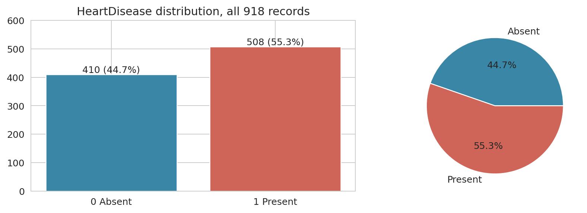

질환 표지 1은 508건으로 55.34%, 표지 0은 410건으로 44.66%이다. 큰 불균형은 아니므로 기본 분석에서는 가중치나 재표본추출을 적용하지 않았다. 전체를 8 대 2로 층화 분할하여 훈련 734건과 테스트 184건으로 나누었다. 훈련 표지는 0이 328건, 1이 406건이며 테스트는 0이 82건, 1이 102건이다. random_state는 42로 고정했다.

그림 1과 2는 전체 파일의 구성 및 품질 점검이다. 이후 EDA 그림 3~8, 통계 검정, 교차검증과 임계값 선택은 훈련 자료에서만 수행했다. 테스트 자료는 모델을 고른 뒤 성능 보고와 사후 설명에 사용했다.

---

# 3 탐색적 데이터 분석

## 3.1 결측 후보와 처리 원칙

그림 2. 0값 기반 결측 후보의 개수와 원래 행 순서상의 분포

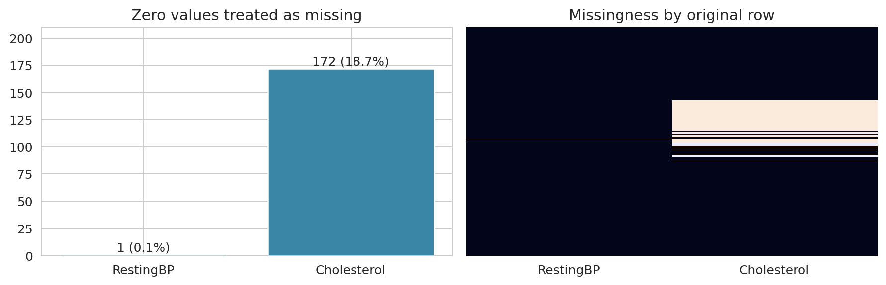

명시적 NA는 없지만 Cholesterol에는 0값 172건(18.74%), RestingBP에는 0값 1건(0.11%)이 있었다. 이 값은 해당 생리 측정치의 유효한 관측으로 보기 어려우므로 결측 후보로 간주했다. FastingBS=0은 혈당 범주이며 Oldpeak=0도 가능한 측정값이므로 그대로 유지했다. 음수 Oldpeak 역시 자동 결측 처리하지 않았다.

| 콜레스테롤 원시 기록 | 표지 0 | 표지 1 | 표지 1 비율 |

|---|---|---|---|

| 0이 아닌 관측값 | 391 | 355 | 47.59% |

| 0값 | 19 | 153 | 88.95% |

콜레스테롤 0값 집단에서 질환 표지 비율이 높은 점은 결측이 결과나 자료 수집 환경과 관련될 가능성을 보여준다. 다만 이 기술 통계만으로 결측 발생 기전이나 수집 기관 효과를 확정할 수 없다. 중앙값 대체와 결측 지표 추가로 처리하되, 콜레스테롤 및 해당 결측 지표를 함께 제거한 민감도 분석도 수행했다.

## 3.2 극단값의 처리

IQR 기준의 극단값은 오류와 같은 뜻이 아니다. 높은 혈압이나 큰 Oldpeak가 중요한 임상 관측일 수 있으므로 IQR 바깥의 값을 일괄 삭제하거나 절단하지 않았다. 비정상 0값 처리와 통계적 극단값 탐지를 구분했다. 대체 중앙값은 전체 자료에서 먼저 구하지 않고 각 훈련 폴드 안에서 학습했다.

---

## 3.3 연속형 변수 분포와 집단 비교

그림 3. 훈련 표지 집단별 연속형 변수의 관측값 분포

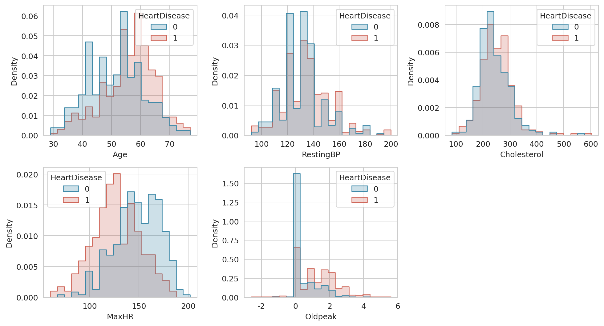

그림 4. 훈련 표지 집단별 박스플롯과 Welch 검정

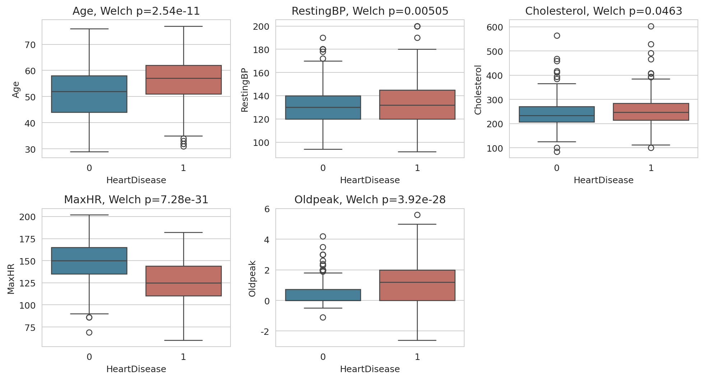

표지 1 집단은 연령과 Oldpeak가 높고 MaxHR가 낮은 방향으로 분포했다. 두 집단의 분포가 겹치므로 하나의 수치만으로 모든 기록을 정확히 구분할 수는 없다. 콜레스테롤 그래프는 0값을 제거한 관측치에 한정되어 있어 결측 집단의 분포를 보여주지 않는다. 그림의 p값은 보정 전 값이며 다음 표에서 Holm 보정 결과를 확인한다.

---

## 3.4 집단 차이 검정과 상관관계

| 변수 | n0 / n1 | 평균 0 | 평균 1 | Welch t | Holm p |

|---|---|---|---|---|---|

| Age | 328/406 | 51.28 | 55.92 | -6.784 | 7.61e-11 |

| RestingBP | 328/406 | 130.82 | 134.53 | -2.812 | 0.0101 |

| Cholesterol | 315/290 | 241.91 | 251.61 | -1.996 | 0.0463 |

| MaxHR | 328/406 | 148.07 | 126.93 | 12.119 | 3.64e-30 |

| Oldpeak | 328/406 | 0.42 | 1.22 | -11.495 | 1.57e-27 |

등분산을 가정하지 않는 Welch 독립표본 검정을 사용하고 5개 연속형 검정에 Holm 보정을 적용했다. 보정 후 모든 변수의 p값이 0.05 미만이었으나, 콜레스테롤은 p=0.0463으로 경계에 가까웠다. 결측이 있는 관측은 해당 변수의 검정에서만 제외했다. 집단 차이의 유의성은 모델에서의 추가 예측 기여나 인과적 효과를 보장하지 않는다.

그림 5. 훈련 연속형 변수 간 피어슨 상관과 목표 표지와의 상관

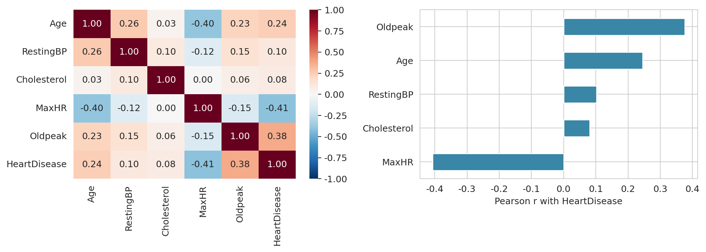

HeartDisease와의 상관은 Oldpeak가 0.377, MaxHR가 -0.407, Age가 0.245이었다. 이진 목표와 연속형 변수의 피어슨 상관은 점이연 상관과 일치한다. 결측이 없는 쌍을 사용했으므로 모든 상관계수가 동일한 표본 수에서 계산된 것은 아니다. 범주형 변수에는 임의의 숫자 코딩으로 피어슨 상관을 계산하지 않았다.

---

## 3.5 주요 변수의 산점도 행렬

그림 6. Age MaxHR Oldpeak의 훈련 표지별 산점도 행렬

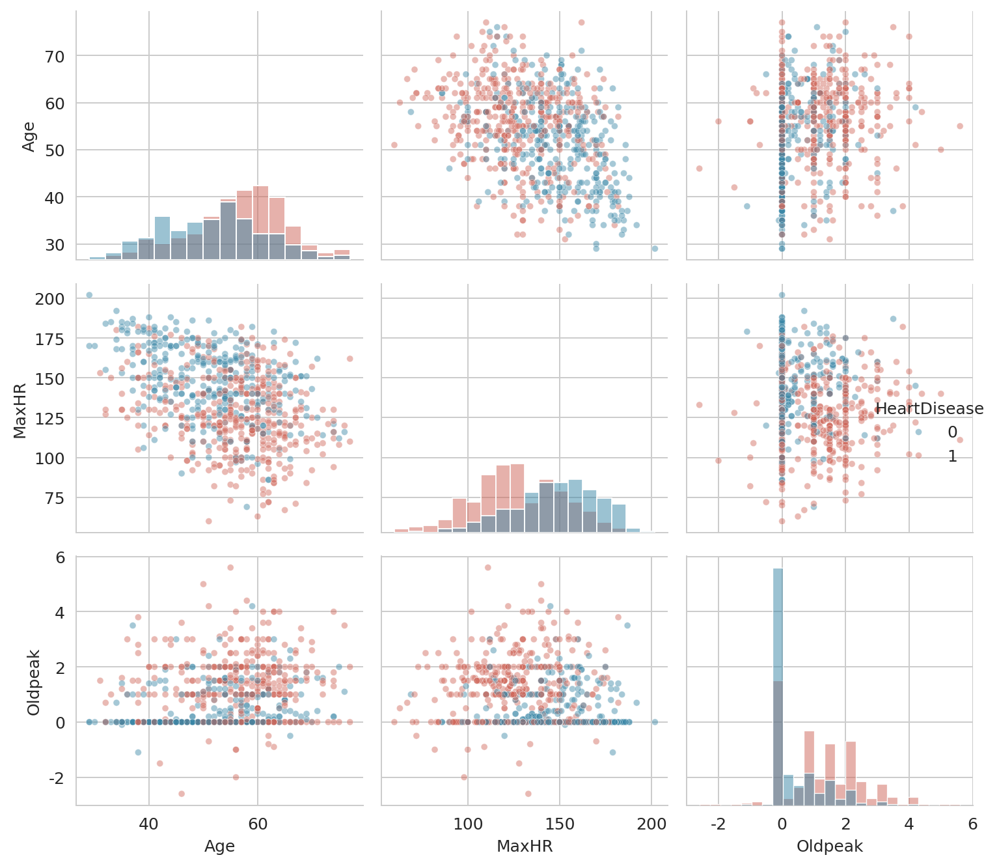

MaxHR가 낮고 Oldpeak가 큰 영역에 표지 1 기록이 상대적으로 많이 분포한다. 연령과 운동검사 지표가 함께 변하는 부분도 보이지만, 산점도만으로 변수 간의 인과 방향을 알 수는 없다. 단변량 차이가 모델의 다변량 분류에서도 유지되는지는 이후의 성능 평가와 중요도 분석으로 확인했다.

---

## 3.6 이상값과 범주별 표지 비율

그림 7. 훈련 관측값의 IQR 1.5배 기준 극단값 개수

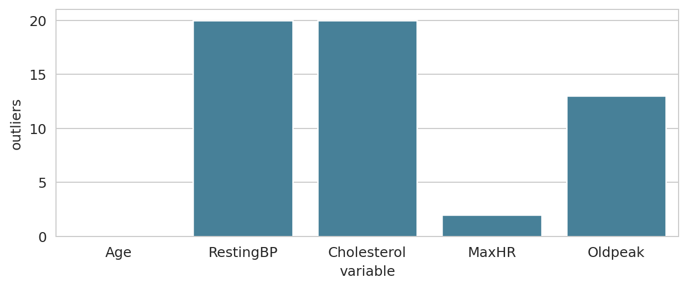

IQR 기준 극단값은 Age 0건, RestingBP 20건, Cholesterol 20건, MaxHR 2건, Oldpeak 13건이다. 이는 자동 삭제 대상이 아니라 원자료 확인을 우선할 후보이다. 이번 분석에서는 위 기록을 보존했다.

그림 8. 훈련 연령대 흉통 유형 ST 기울기별 표지 비율과 Wilson 95퍼센트 구간

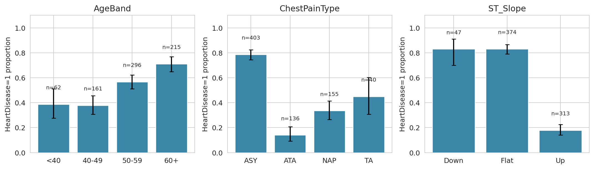

연령대별 표지 1 비율은 40세 미만 38.71%(24/62), 40대 37.89%(61/161), 50대 56.76%(168/296), 60세 이상 71.16%(153/215)였다. 흉통 ASY는 78.66%(317/403), ATA는 13.97%(19/136)였고, ST_Slope의 Flat은 83.16%(311/374), Up은 17.89%(56/313)였다.

이 비율은 선택된 임상 표본 안의 표지 비율이다. 일반 인구의 연령별 발병률로 해석할 수 없으며 무증상이 질병을 일으킨다는 뜻도 아니다. 검사 대상자의 선택 과정이나 진단 관련 측정이 함께 반영되어 있을 수 있다. 막대 위 n과 신뢰구간은 작은 집단의 불확실성을 읽기 위한 정보이다.

---

# 4 데이터 전처리 및 방법론

## 4.1 누수를 방지하는 전처리

첫 단계에서 전체 열이 일치하는 중복을 제거하도록 코드를 구성했지만 이번 파일에서 실제 제거된 행은 없었다. 다음으로 미리 정의한 두 열의 0값을 NA로 바꾸고 훈련과 테스트를 층화 분할했다. 이 규칙은 목표 표지나 표본 평균을 학습하는 과정이 아니므로 분할 전에 적용할 수 있다.

| 단계 | 연속형 5개 | 범주형 6개 |

|---|---|---|

| 결측 처리 | 훈련 중앙값과 결측 지표 | 훈련 최빈값 |

| 변환 | StandardScaler | OneHotEncoder |

| 미지 값 | 훈련 평균 및 표준편차로 변환 | handle_unknown=ignore |

| 학습 범위 | 교차검증 내부 훈련 폴드 | 교차검증 내부 훈련 폴드 |

ColumnTransformer와 Pipeline으로 전처리와 모델을 연결했다[5]. 각 검증 폴드는 훈련 폴드에서 계산된 중앙값, 평균, 표준편차, 범주 목록으로 변환된다. 테스트 자료의 통계량은 이 과정에 사용하지 않는다. 트리 모델에는 표준화가 필수는 아니지만, 같은 입력 정보를 유지하고 구현을 통일하기 위해 동일한 전처리 파이프라인을 적용했다.

## 4.2 특징 공학의 검증

기본 모델은 원래 11개 변수로 비교했다. 참고 PDF처럼 파생 변수를 추가하되, 중요도가 높게 나왔다는 사실만으로 성능이 개선되었다고 주장하지 않았다. Age×Oldpeak와 MaxHR÷Age의 두 조합을 사전에 정하고 로지스틱 회귀의 동일한 5겹 폴드에서 원변수 모델과 비교했다. 이 조합은 교육용 통계 변환이며 검증된 임상 점수가 아니다.

## 4.3 학습 및 모델 선택 절차

훈련 734건에 StratifiedKFold 5겹, shuffle=True, random_state=42를 적용했다. 모델별 평균 ROC-AUC를 비교하여 가장 높은 모델을 선택하고, 그 모델을 전체 훈련 자료에 적합한 뒤 테스트 184건으로 평가했다. 고정된 설정의 7개 모델 비교이며 광범위한 하이퍼파라미터 탐색을 하지 않았다. 최고 교차검증 점수에는 모델 선택에 따른 낙관성이 남을 수 있으므로 보류 테스트 결과를 함께 제시한다.

---

## 4.4 비교 모델과 고정 설정

| 모델 | 주요 설정 | 비교 목적 |

|---|---|---|

| Logistic Regression | C=1, max_iter=2000 | 해석 가능한 선형 기준선 |

| Decision Tree | max_depth=5, min_samples_leaf=5 | 단일 트리의 복잡도 제한 |

| Random Forest | 250 trees, min_samples_leaf=2, max_features=sqrt | 트리 평균화로 분산 감소 |

| XGBoost | 200 trees, max_depth=3, learning_rate=0.05, subsample=0.9, colsample_bytree=0.9 | 얕은 트리의 점진적 결합 |

| LightGBM | 200 trees, num_leaves=15, learning_rate=0.05, min_child_samples=20 | 리프 중심 부스팅 |

| Gradient Boosting | 150 trees, max_depth=2, learning_rate=0.05 | 전통적 부스팅 비교 |

| MLP | 64 32 16, alpha=0.01, max_iter=1500, early_stopping=True | 비선형 신경망 비교 |

모든 확률적 모델의 random_state는 42이다. MLP 내부 조기 종료는 validation_fraction=0.15, n_iter_no_change=25를 사용했다. XGBoost와 LightGBM은 각각 공식 scikit-learn 호환 분류기를 사용했다[7, 8]. 실제 라이브러리 버전은 부록과 실행 결과 JSON에 기록했다.

## 4.5 평가 지표

정확도는 전체 정답 비율, 정밀도는 양성 예측 중 실제 양성 비율, 재현율은 실제 양성 중 검출 비율이다. F1은 정밀도와 재현율의 조화 평균이며 ROC-AUC는 임계값 전반의 순위 판별력을 나타낸다. 특이도는 실제 음성 중 음성으로 맞힌 비율이다. AP는 정밀도와 재현율 곡선을 요약하며, 보정된 개인 발병 확률을 뜻하지 않는다.

기본 임계값은 0.5로 고정했다. 재현율만 높이면 모든 기록을 양성으로 예측하는 기준선도 좋아 보일 수 있으므로 특이도와 혼동 행렬을 함께 확인했다. 비용과 실제 업무 수용 능력이 제공되지 않았으므로 의료 운영의 최적 임계값을 확정하지 않았다.

---

# 5 실험 결과

## 5.1 교차검증 성능과 모델 선택

| 모델 | 훈련 CV 평균 AUC | 폴드 간 표준편차 |

|---|---|---|

| Random Forest | 0.9331 | 0.0279 |

| XGBoost | 0.9324 | 0.0313 |

| Gradient Boosting | 0.9285 | 0.0363 |

| Logistic Regression | 0.9280 | 0.0435 |

| LightGBM | 0.9255 | 0.0279 |

| MLP | 0.9056 | 0.0358 |

| Decision Tree | 0.8774 | 0.0523 |

그림 14. 훈련 자료의 모델별 5겹 ROC AUC 분포

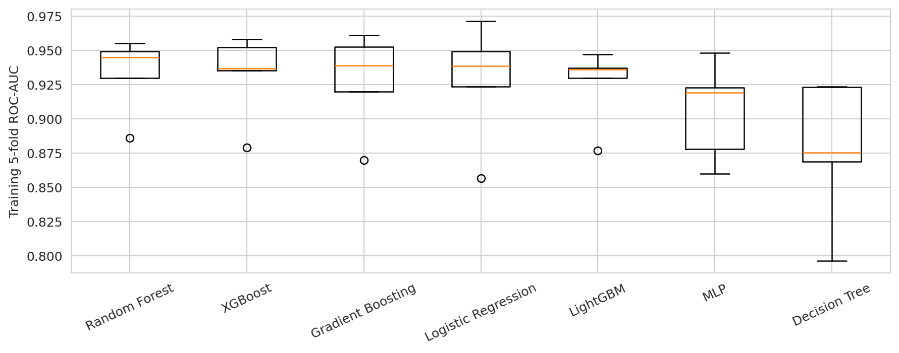

Random Forest 평균 0.9331이 가장 높아 최종 모델로 선택했다. XGBoost는 0.9324로 매우 근접하며 두 평균의 차이는 약 0.0008에 불과하다. 따라서 Random Forest가 모든 상황에서 우월하다고 결론 내리지 않는다. 단일 Decision Tree는 평균 0.8774, 폴드 표준편차 0.0523으로 이 설정에서 성능과 안정성이 상대적으로 낮았다.

박스플롯은 독립 실험 5회가 아니라 훈련 자료를 나눈 5개 폴드의 점수이다. 겹치는 훈련 표본이 있으므로 표준편차를 그대로 모집단 신뢰구간으로 해석해서는 안 된다. 테스트 결과를 본 뒤 모델 순서를 바꾸거나 설정을 다시 최적화하지 않았다.

---

## 5.2 보류 테스트에서의 모델 성능

| 모델 | 정확도 | 정밀도 | 재현율 | F1 | AUC |

|---|---|---|---|---|---|

| Random Forest | 0.9022 | 0.8889 | 0.9412 | 0.9143 | 0.9387 |

| XGBoost | 0.8913 | 0.9100 | 0.8922 | 0.9010 | 0.9347 |

| Gradient Boosting | 0.9022 | 0.9038 | 0.9216 | 0.9126 | 0.9320 |

| Logistic Regression | 0.8967 | 0.8952 | 0.9216 | 0.9082 | 0.9324 |

| LightGBM | 0.8696 | 0.8900 | 0.8725 | 0.8812 | 0.9272 |

| MLP | 0.8696 | 0.8611 | 0.9118 | 0.8857 | 0.9321 |

| Decision Tree | 0.7880 | 0.8182 | 0.7941 | 0.8060 | 0.8638 |

표는 훈련 교차검증 평균 순서이며 테스트 AUC로 다시 정렬하지 않았다. Random Forest의 테스트 정확도는 0.9022, 정밀도 0.8889, 재현율 0.9412, F1 0.9143, AUC 0.9387이었다. Gradient Boosting도 같은 정확도 0.9022를 기록했지만 위음성 및 위양성 구성은 다르다.

그림 9. 7개 모델의 테스트 성능 지표 비교

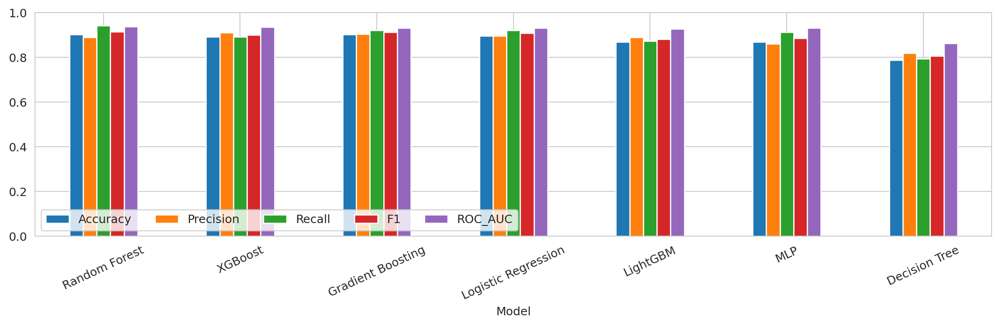

훈련 표지의 다수 클래스를 모든 테스트 기록에 예측하는 기준선의 정확도는 55.43%, AUC는 0.5였다. 이 기준선의 재현율은 100%이지만 특이도는 0%이다. 따라서 이번 모델들의 결과는 재현율 하나만으로 해석하지 않고 기준선 대비 판별력과 오류 구성을 함께 읽어야 한다.

---

## 5.3 ROC와 정밀도 재현율 곡선

그림 10. 보류 테스트의 ROC 곡선과 정밀도 재현율 곡선

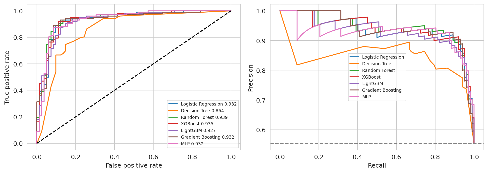

ROC 곡선에서 Random Forest와 여러 부스팅 모델 및 로지스틱 회귀가 비슷한 영역을 차지했다. Random Forest의 AP는 0.9419이며 테스트 양성 비율에 해당하는 기준 AP 0.5543보다 높았다. Decision Tree의 테스트 AUC 0.8638은 다른 모델보다 낮았지만, 이것만으로 과적합의 원인을 확정할 수는 없다. 트리 깊이 제한, 표본 변동, 선택한 입력 정보 등이 영향을 줄 수 있다.

## 5.4 선택 모델 AUC의 불확실성

Random Forest의 테스트 AUC 0.9387에 대해 음성 82건과 양성 102건을 각 클래스 안에서 복원 추출한 층화 부트스트랩 2,000회를 수행했다. 2.5%와 97.5% 분위수로 계산한 조건부 95% 구간은 0.8961~0.9724였다. 표본이 작기 때문에 점추정치만으로 성능을 확정하지 않는 것이 적절하다.

이 구간은 이미 학습된 모델에 대한 테스트 표본의 변동만 반영한다. 훈련 자료를 새로 수집했을 때의 변화, 모델 선택 과정, 수집 기관 간 차이는 포함하지 않는다. 다른 모델과의 AUC 차이에 대한 쌍체 검정을 수행하지 않았으므로 단일 테스트 점수 차이를 통계적 우열이라고 표현하지 않았다.

---

## 5.5 혼동 행렬과 임계값 조정

그림 11. 7개 모델의 혼동 행렬 가로축 예측 세로축 실제

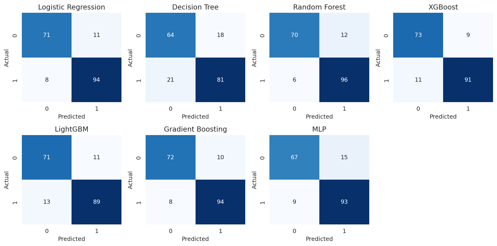

Random Forest는 양성 102건 중 96건을 검출하고 6건을 놓쳤다. 음성 82건 중 70건을 음성으로, 12건을 양성으로 예측했다. 동일한 재현율이라도 위양성 수가 달라질 수 있으므로 혼동 행렬은 후속 확인 검사 규모를 판단할 때 필요한 정보이다.

| RF 임계값 | TN | FP | FN | TP | 재현율 | 특이도 |

|---|---|---|---|---|---|---|

| 0.5000 | 70 | 12 | 6 | 96 | 0.9412 | 0.8537 |

| 0.4934 OOF 선택 | 69 | 13 | 6 | 96 | 0.9412 | 0.8415 |

훈련 OOF에서 재현율 0.90 이상을 만족하면서 특이도가 가장 높은 임계값은 0.493378이었다. 훈련 OOF 재현율은 0.9039, 특이도는 0.8018이었다. 테스트에서는 재현율이 그대로이고 위양성만 1건 늘었다. 따라서 임계값 조정이 이번 보류 테스트에서 개선을 가져왔다고 주장하지 않으며 기본 0.5 결과를 주 분석으로 유지한다.

---

## 5.6 특징 중요도 분석

그림 12. Random Forest의 인코딩 후 특징 MDI 상위 항목

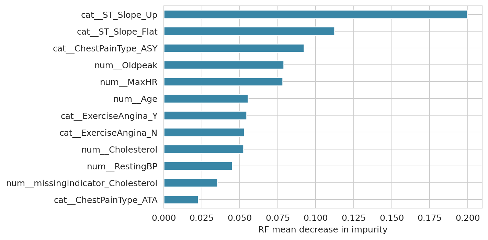

MDI는 트리 분할에서 누적된 불순도 감소를 요약한다. 원핫 인코딩된 하나의 범주 수준과 원래 변수 전체는 단위가 다르며, 연속형이나 분할 후보가 많은 변수에 유리할 수 있다. 따라서 원래 변수 전체를 섞는 순열 중요도로 확인했다[6].

그림 13. RF와 XGBoost의 원래 변수 단위 테스트 순열 중요도

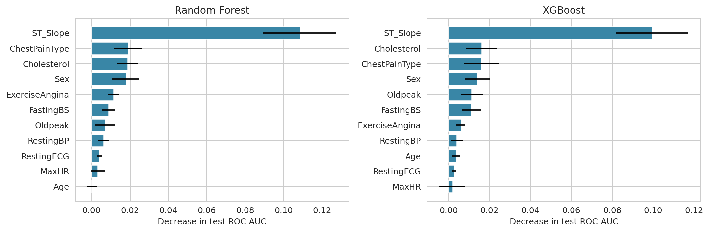

Random Forest에서 ST_Slope를 섞었을 때 AUC 감소 평균은 0.1085, 반복 표준편차는 0.0190이었다. 다음은 ChestPainType 0.0190, Cholesterol 0.0186, Sex 0.0178이었다. 15회 반복의 오차막대는 순열 변동이며 인과 효과의 구간이 아니다. 상관된 변수는 서로 정보를 보완하여 개별 중요도가 작게 보일 수 있다. 사후 설명 결과를 이용해 모델을 다시 선택하지 않았다.

---

## 5.7 파생 변수와 콜레스테롤 제거 실험

| 로지스틱 회귀 입력 | 훈련 CV 평균 AUC | 기본 대비 변화 |

|---|---|---|

| 원래 11개 변수 | 0.9280 | 기준 |

| Cholesterol와 그 결측 지표 제외 | 0.9226 | -0.0054 |

| Age×Oldpeak와 MaxHR÷Age 추가 | 0.9271 | -0.0009 |

두 파생 변수를 추가해도 교차검증 평균은 개선되지 않았다. 따라서 특징 공학이 항상 유익하다는 결론을 내리지 않았으며 기본 모델의 원래 변수 구성을 유지했다. 콜레스테롤 제거 후 AUC 감소는 작았지만, 이 실험은 로지스틱 회귀에 한정된다. 모든 모델에서 콜레스테롤이 불필요하다는 뜻은 아니다.

## 5.8 성별 하위집단 성능

| 기록상 성별 | 테스트 n | 양성 n | 재현율 | Wilson 95% 구간 | AUC |

|---|---|---|---|---|---|

| F | 38 | 6 | 0.8333 | 0.4365~0.9699 | 0.9635 |

| M | 146 | 96 | 0.9479 | 0.8838~0.9776 | 0.9175 |

여성 표지 양성은 6건뿐이고 그중 5건을 검출했다. 남성 양성 96건 중 91건을 검출했다. 여성 AUC가 높게 보여도 재현율 신뢰구간이 넓으므로 공정성이 확보되었다고 판단할 수 없다. 성별 변수의 높은 중요도도 생물학적 원인뿐 아니라 표본 구성과 진료 선택 과정을 반영할 수 있다.

그림 15. 훈련 교차검증 상위 3개 모델의 테스트 지표 레이더

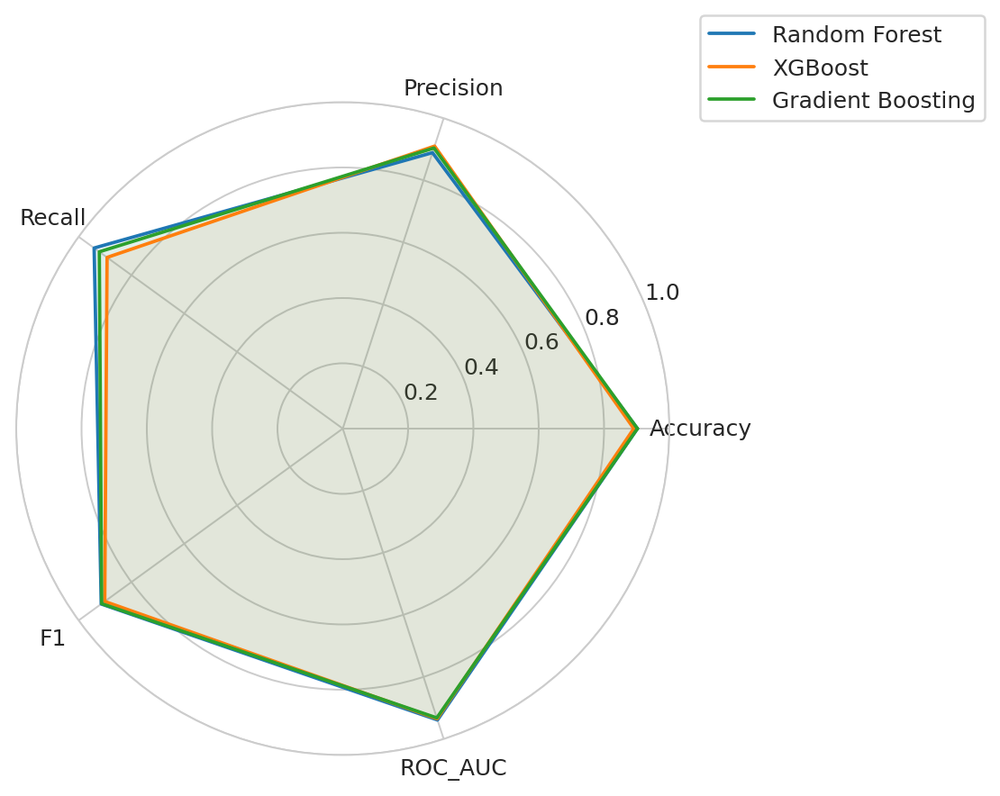

레이더 차트는 지표 간 모양을 비교하기 위한 보조 시각화이다. 다각형 면적은 공식적인 종합 성능 점수가 아니며 지표의 중요도나 실제 비용을 반영하지 않는다. 모델 선택 근거는 앞서 정의한 훈련 교차검증 평균 AUC이다.

---

# 6 토론

## 6.1 주요 발견

첫째, 표면적으로 결측이 없는 파일도 비정상적인 0값을 점검해야 했다. 특히 콜레스테롤의 결측 후보는 표지 1 집단에 집중되었다. 이는 대체 전략뿐 아니라 데이터가 어떤 경로로 수집되었는지를 함께 고려해야 함을 보여준다.

둘째, 이 설정에서는 Random Forest가 높은 판별 성능을 보였고 로지스틱 회귀도 테스트 AUC 0.9324로 경쟁력 있는 기준선이었다. 모델 복잡도가 커진다고 항상 더 좋은 결과가 나오지는 않았다. Random Forest와 XGBoost의 교차검증 평균 차이는 매우 작아 외부 자료에서 순위가 달라질 가능성이 있다.

셋째, ST_Slope는 이번 모델이 예측에 많이 의존하는 변수였다. 다만 운동검사와 심전도 정보는 질환 평가 과정과 가까운 측정이다. 이 모델을 검사를 받기 전의 일반인을 조기에 선별하는 도구로 바꾸려면 사용 가능한 변수와 예측 시점을 새로 정의해야 한다.

넷째, 파생 변수 추가와 임계값 조정은 이번 실험에서 보류 성능의 개선으로 이어지지 않았다. 부정적인 결과도 그대로 보고함으로써 기법을 적용했다는 사실과 효과가 입증되었다는 주장을 구분했다.

## 6.2 경영 및 운영 관점의 해석

분류 모델을 업무에 활용하려면 위음성과 위양성의 비용을 함께 정해야 한다. 기본 Random Forest의 테스트 양성 예측은 108건이며 그중 12건은 위양성이다. 모든 양성 예측을 추가 확인으로 연결한다면 이 108건이 필요한 업무량의 한 예가 된다. 그러나 표본의 질환 표지 비율이 일반 환경과 다르므로 이 수치를 그대로 병원의 실제 검사 수요로 확대할 수 없다.

임계값 0.4934에서는 양성 예측이 109건으로 늘고 검출된 실제 양성은 늘지 않았다. 이러한 결과는 재현율 목표가 훈련 자료에서 충족되더라도 다른 표본에서 같은 이득을 보장하지 않음을 보여준다. 도입 판단에는 외부 기관 평가, 확률 보정, 실제 유입 환자 구성, 확인 검사 수용 능력과 비용 추정이 더 필요하다.

---

## 6.3 연구의 한계와 후속 분석

## 표본과 시대의 대표성

918건은 제한된 임상 자료이며 한국의 현재 일반 인구를 대표하지 않는다. 성별·연령 구성과 측정 환경이 바뀌면 성능도 달라질 수 있다.

## 기관 및 환자 식별 정보의 부재

원자료 계열은 여러 기관을 포함하지만 통합 CSV에는 기관과 환자 ID가 없다. 기관 외부 검증이나 환자 단위 중복 점검을 수행할 수 없었다.

## 결측 처리의 가정

0값을 결측으로 보는 판단과 중앙값 대체는 분석 가정이다. 결측 지표가 기관별 기록 관행을 대리할 가능성도 있어 외부 환경에서 불안정할 수 있다.

## 모델 선택 및 표본 변동

한 번의 층화 테스트 분할과 5겹 훈련 교차검증을 사용했다. 반복 중첩 교차검증을 수행하지 않았으며 모델 간 성능 차이에 대한 유의성 검정도 하지 않았다.

## 예측 시점과 사용 가능 정보

흉통·심전도·운동검사 정보가 포함되어 있다. 진료 전 선별 또는 미래 사건 예측으로 확장하려면 표적과 측정 시점을 재정의해야 한다.

## 확률과 인과 해석의 한계

출력 확률에 대해 별도 보정이나 의사결정곡선 분석을 수행하지 않았다. 변수 중요도와 집단 차이로 치료 효과나 발병 원인을 주장할 수 없다.

후속 연구에서는 기관 정보가 있는 외부 코호트 확보를 우선하고, 측정 시점이 명확한 상태에서 시간 순서 분할을 적용해야 한다. 이후 확률 보정, 여러 임계값의 순편익 평가, 충분한 하위집단 표본 확보를 순차적으로 진행하는 것이 적절하다.

---

# 7 결론

본 보고서는 Kaggle에 공개된 심장질환 통합 데이터의 구조를 점검하고, 전처리부터 모델 선택까지를 훈련 자료 안에서 수행하는 비교 실험을 구성했다. 918건 중 콜레스테롤 0값 172건과 혈압 0값 1건을 결측 후보로 처리했다. 범주형 특성은 원핫 인코딩했으며 원래 11개 입력 변수로 7개 모델을 비교했다.

Random Forest의 훈련 5겹 평균 AUC는 0.9331, 보류 테스트 AUC는 0.9387이었다. 기본 임계값 0.5에서 정확도는 90.22%, 재현율은 94.12%이며 양성 102건 중 6건을 놓쳤다. ST_Slope의 순열 중요도가 가장 컸지만 이를 발병 원인으로 해석하지 않았다. 파생 변수는 성능을 개선하지 않았고 OOF 임계값 조정도 테스트 재현율을 높이지 못했다.

이 결과는 주어진 임상 표본 안에서 분류가 가능함을 보여준다. 실제 진료에 필요한 대표성, 외부 일반화, 공정성, 확률 보정, 운영 비용은 별도 검증이 필요하다. 최종 판단의 핵심은 높은 숫자 하나가 아니라 자료 확보 경로와 학습 절차, 오류 구성, 불확실성을 함께 제시하는 데 있다.

## 부록 재현 정보

노트북은 동일한 CSV를 내장하고 있어 heart.csv가 없으면 원본 분석 바이트를 복원한다. 분석 결과는 results 폴더의 CSV와 summary.json, 그림 15개로 저장된다. 설치 패키지는 requirements.txt에 기록했다. 모든 코드 셀은 순서대로 실제 실행하였으며 실행 출력과 그림을 노트북에 보존했다.

| 항목 | 값 |

|---|---|

| 분할 | train_test_split test_size=0.2, stratify=y, random_state=42 |

| 교차검증 | StratifiedKFold n_splits=5, shuffle=True, random_state=42 |

| 중요도 | 테스트 순열 15회, scoring=roc_auc, random_state=42 |

| AUC 구간 | 테스트 클래스 내 복원추출 2000회, 2.5% 및 97.5% 분위수 |

| 실행 버전 | Python 3.12.14, numpy 2.3.5, pandas 2.2.3, sklearn 1.8.0, scipy 1.17.0, xgboost 3.4.1, lightgbm 4.7.0 |

CSV SHA256
948420b084d8a3a0ca42b8419fce9aee175879e43f8aedf712377899a67aa49b

조원별 실제 수행 내역은 제공되지 않아 임의로 기재하지 않았다. 함께 제공한 발표 원고의 4인 분담은 발표 연습을 위한 제안이며 실제 기여도 기록을 대신하지 않는다.

---

# 참고문헌

1 fedesoriano. Heart Failure Prediction Dataset. Kaggle.

https://www.kaggle.com/datasets/fedesoriano/heart-failure-prediction

2 Janosi A, Steinbrunn W, Pfisterer M, Detrano R. Heart Disease. UCI Machine Learning Repository.

https://doi.org/10.24432/C52P4X

3 UCI Machine Learning Repository. Statlog Heart.

https://archive.ics.uci.edu/dataset/145/statlog+heart

4 benbobyabraham. heart_failure_prediction_dataset_kaggle. 본 분석 CSV 확보 미러.

https://github.com/benbobyabraham/heart_failure_prediction_dataset_kaggle

5 scikit-learn. Common pitfalls and recommended practices.

https://scikit-learn.org/stable/common_pitfalls.html

6 scikit-learn. Permutation feature importance.

https://scikit-learn.org/stable/modules/permutation_importance.html

7 XGBoost. Python API Reference.

https://xgboost.readthedocs.io/en/stable/python/python_api.html

8 LightGBM. Python API.

https://lightgbm.readthedocs.io/en/stable/Python-API.html

9 제공된 G12 Final Report. 파이마 인디언 당뇨병 데이터셋 머신러닝 기반 종합 분석 보고서. 문서 구조와 분석 항목 참고 자료.

웹 자료 확인 및 CSV 확보일은 2026년 10월 30일이다. 데이터 변수 설명의 검증 근거로 Kaggle 및 UCI 출처를 사용하고, 공개 미러는 실제 바이트 확보 경로로 구분하여 기재하였다.
